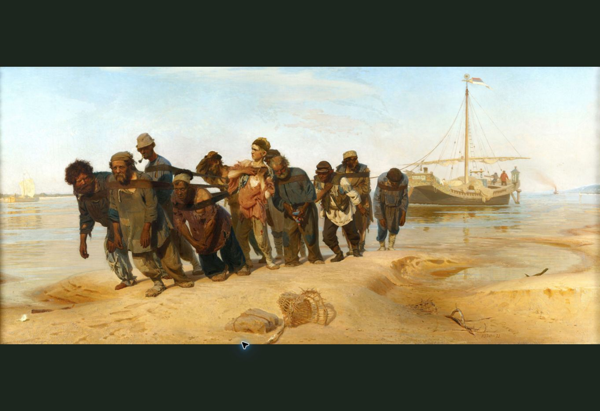
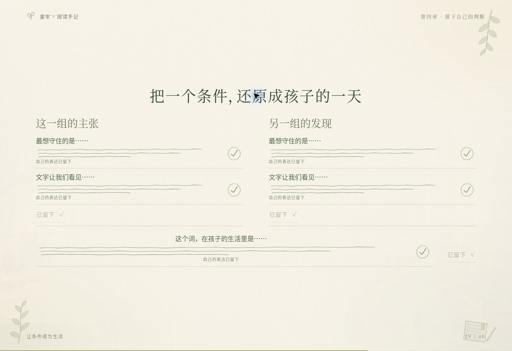
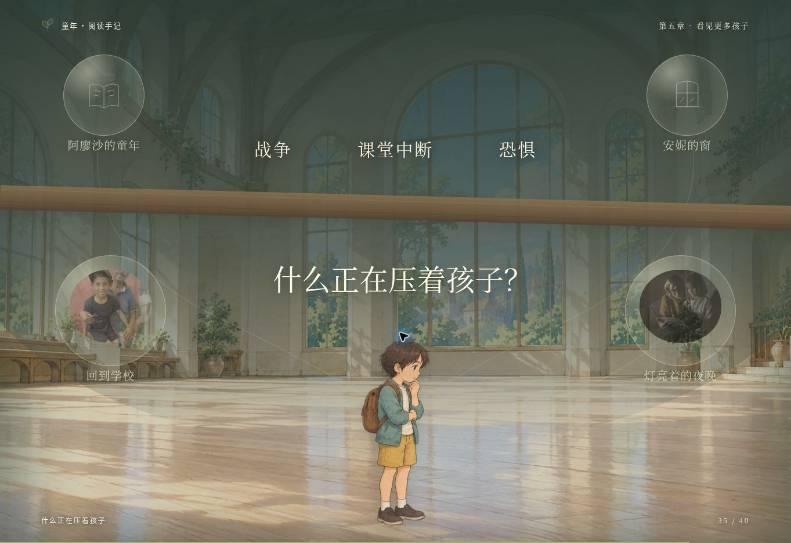

# 《童年》公开课课件

面向六年级课堂投影的 40 幕交互课件，配有**完整阅读版约 42 分 30 秒**的教师逐字稿。手绘画本中的小路、书桌、窗与纸面通过镜头移动相连，阅读材料在画面中央的留白处停稳。课堂保留初判、证据并读、三关阅读卡修复、小组探究与退出卡。

## 画面预览




开场的小路上，孩子会依次遇见伙伴、追球的同学和树荫。场景之间通过平移、轻推与景深变化相连；长段文字进入留白后停稳，细节动画结束后保持最后画面。

中段用书签收拢与回到原文、因果线断开与接回、窗边物件和两类证据汇合，连接阅读与判断。教师讲完后推进，纸面以笔迹和印记留下表达；外部材料逐份展开、逐份收回，最后才一起汇聚。






## 下载与离线使用

1. 在仓库页面选择 **Code → Download ZIP**，下载整个项目。
2. **完整解压**，保留 `index.html` 与 `assets`、`styles`、`scripts` 文件夹的相对位置。
3. 用浏览器打开解压后的 `index.html`，即可开始授课。

无需构建、安装依赖或启动服务器。插画、原画、真实资料照片、中文字体与课堂数据都随项目提供，可完全离线使用。素材已拆为独立文件并压缩；**仅下载 `index.html` 无法完整播放**。

课前请在实际投影设备上检查文字大小，并离线试播开场、长段原文、现实资料与结尾。

## 完整阅读版与时间安排

本版加入 **9 页外部阅读**：安妮 5 页，亚门和瓦尔瓦拉各 2 页。安妮四幕仍安排在 23:00—27:00；两份报道由原来的各 15 秒改为各 90 秒，因此全课增加 2 分 30 秒。两分钟并读、五分钟小组讨论和九十秒退出卡完整保留。

| 阅读环节 | 时间与安排 |
| --- | --- |
| 安妮的藏身生活 | 23:00—24:00，两页背景与短引阅读 |
| 送进来的帮助 | 24:00—24:40，一页背景阅读 |
| 安妮的安静与愿望 | 24:40—26:10，两页阅读后展开愿望剪影 |
| 处境追问与小组准备 | 26:10—27:00，随后开始完整五分钟讨论 |
| 亚门的报道 | 36:35—38:05，两页阅读后收回资料 |
| 瓦尔瓦拉的报道 | 38:05—39:35，两页阅读后收回资料 |
| 退出卡与结语 | 40:30—42:00 独立书写，42:30 结束 |

教师先让学生静读，再用一句话连接材料，不逐句读屏。计时器只是可选的阅读提醒，可以暂停；阅读页和场景都能继续停留，不会到时自动换页。安妮藏身生活、帮助、愿望与两份报道的默认阅读提醒分别为 50、30、70、70、70 秒，场景总时长另留讲述、圈画或收回资料的时间。

### 材料说明

安妮的五页包含三处短引文工作译文，以及依据安妮之家资料整理的背景与阅读提示；两份报道各含两句采访短引工作译文，其余为报道内容整理。页面区分这些文字身份，教师资料与逐字稿附录保留原始网页网址、报道日期和图片说明。整理文字没有被标成日记或报道的连续原文，《童年》已有原著选段保持不变。

如需加入所用中文出版译本中的大段日记原文，请补充实际使用版本的相关页面或可用文本，并提供书名、译者和版本信息，以便逐段核对后替换阅读页。

## 课堂操作

| 操作 | 按键或鼠标 |
| --- | --- |
| 下一步：先完成本幕步骤，再进入下一幕 | →、空格或 PageDown，或控制栏“下一步” |
| 全屏时下一步 | 在无交互控件处单击左键，或单击右键 |
| 上一步：先退回本幕步骤，再返回上一幕 | ← 或 PageUp，或控制栏“上一步” |
| 进入或退出全屏 | F，或控制栏全屏按钮 |
| 打开目录 | M |
| 查看教师讲稿 | N |
| 清除本幕象征笔迹，从初始步骤重演 | R |
| 开始或暂停计时 | T |
| 关闭面板 | Esc |

翻页笔、键盘、控制栏和全屏空白点击使用相同的推进规则：先进入本幕的下一阅读页，读到末页后再执行笔迹、剪影或资料收回动作；本幕步骤全部完成后，再次推进才切换场景。全屏中的空白左键与右键效果相同；按钮、关键词划线、选中文字和已打开的面板保留各自操作。普通窗口模式下，空白处点击不推进。将鼠标移到屏幕下方，可显示控制栏。

浏览器不支持页面全屏时会进入专注模式，点击规则相同，可再按 F11 隐藏浏览器边框。

每一步都由教师手动推进，资料随进入对应场景展开，讲完后再点击收回，不按倒计时自动开关，也不识别语音。同幕步骤不重置计时；动画结束后停住，倒计时归零只作提醒，不自动切走阅读材料。两分钟并读、五分钟讨论与九十秒退出卡保留完整时间。

学生在阅读本上写补语、理由、赞美与小组主张，教师无需在网页打字。讲述与作答完成后，点击让短线笔迹和印记象征“这次修订已经留下”；画面不代写学生实际发言，也不填入预设答案。点击原文关键词仍可划线或取消；断箭头关卡的两条箭头也可分别断开与恢复。

### 需要在讲述中点击的节点

| 场景 | 讲述与操作顺序 |
| --- | --- |
| 三张阅读卡修复 | 学生在纸上完成并交流后，按下一步或“留下这次修订”显示笔迹与印记；再按下一步进入后续场景。 |
| 两组交流 | 第一组讲完后按下一步，同时留下该组主张与证据的笔迹；第二组讲完后再按下一步留下第二组；日常生活补充后再按下一步留下补充。三次均不输入文字，第四次推进才进入作者回望。 |
| 安妮的藏身生活与帮助 | 藏身生活的第一页读完后按下一步看第二页，再推进到帮助的一页；正文落定后保持静止。 |
| 安妮的愿望 | 先读“安静，并不总是安宁”，按下一步看愿望短引；读完并指认后，再按下一步展开骑车、跳舞、吹口哨的玻璃剪影。教师说一句连接，再推进到限制处境的追问。 |
| 《伏尔加河上的纤夫》 | 入幕全屏展示原画并保留完整构图；讲完“把目光接回他的讲述”后按下一步收回书页，再按下一步进入外祖父原文。 |
| 现实资料 | 起初只见封存的透明记忆；进入对应场景才展开照片与第一页。第一页读完，按下一步看第二页；读完并说一句连接后，再按下一步收回，随后再按才进入下一场景。亚门、瓦尔瓦拉均按此顺序。 |
| 房间变窄 | 先停在安静房间；讲到“房间一点点变窄”时按下一步，书中、安妮与两份现实材料同时汇聚，灰影与木梁随后压下，约 6 秒后停住。讲完再推进到日常连接。 |

回访已完成的记录场景会保留笔迹，可继续向后推进。“上一步”优先退回本幕步骤或上一阅读页，包括撤回对应笔迹或重新打开已收回的资料；**R** 从本幕第一页重演并清除本幕象征笔迹，关键词和箭头选择仍保留。目录中的清空按钮可清除整节课堂状态；不会恢复上一版教师输入的内容。结尾撑开房间与接住铅笔仍随进入场景开始，与原旁白同步。

目录中另有“投影增强”与“简静动画”。声音默认关闭。教师讲稿与详细资料来源在教师面板显示；学生阅读页保留背景整理、报道整理和短引文的必要身份提示。

## 教师讲稿

[下载教师逐字稿（Word）](teacher_script.docx)

逐字稿与网页的 40 幕逐一对应；“画面与操作”标明阅读页切换、同幕记录、资料展开与收回、记忆汇聚的点击节点。安妮和两份报道改为先静读、再短连接，时间表同步为约 42 分 30 秒。附录逐页列出新增阅读文字和来源，《童年》原文与原教学立意保留，学生的独立书写仍在纸上完成。

## 项目结构

| 文件或目录 | 用途 |
| --- | --- |
| `index.html` | 课件入口 |
| `assets/` | 本地插画、照片、字体与字体许可 |
| `styles/` | 画面布局、纸张效果与动画样式 |
| `scripts/lesson-data.js` | 场景顺序、阅读材料、教师讲稿与资料来源 |
| `scripts/reading-data.js` | 安妮与现实报道的 9 页扩展阅读、文字身份和原始来源 |
| `scripts/scenery.js` | 场景细节与手绘物件 |
| `scripts/story-flow.js` | 同幕步骤、前后推进与完成状态 |
| `scripts/learning-motion.js` | 阅读卡、愿望剪影与中段连续动画 |
| `scripts/app.js` | 镜头切换、课堂互动、计时和全屏操作 |
| `teacher_script.docx` | 便于备课和打印的教师逐字稿 |

## 开发验证

维护代码时，可在项目根目录运行以下命令，无需安装依赖：

```bash
node --test tests/*.test.cjs
node --check scripts/app.js
node --check scripts/scenery.js
node --check scripts/story-flow.js
node --check scripts/learning-motion.js
node --check scripts/reading-data.js
```

这些检查用于验证交互逻辑与脚本语法。发布前仍应在实际浏览器中检查镜头衔接、文字留白、长段落显示、离线加载，以及全屏点击和按钮操作。

